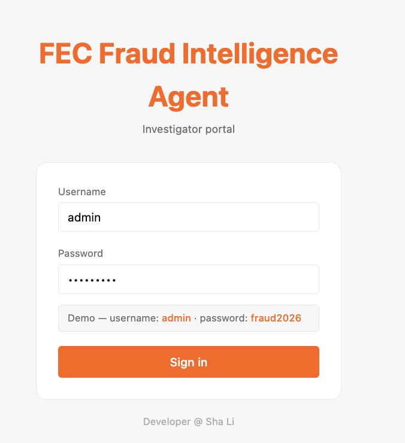
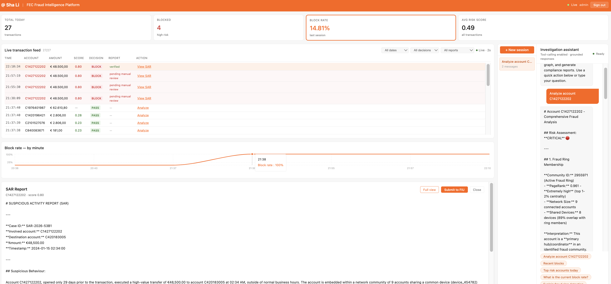

# Anti-Fraud AI Agent

Production-oriented fraud investigation platform for bank FEC teams. Combines PySpark, Neo4j graph analytics, LangGraph agent, and Claude LLM to automate transaction screening and SAR report generation.

**Sha Li · AI Engineer · Netherlands**

---

## Screenshots

---

## Tech stack

- **Data** — PySpark · Neo4j (Louvain + PageRank) · Redis Streams · PostgreSQL
- **Backend** — FastAPI · LangGraph · Claude Haiku + Sonnet · Pydantic v2
- **Frontend** — React · TypeScript · Vite · Recharts
- **Infrastructure** — Docker Compose

---
## Key Features

- **Fraud Detection:** Deterministic risk scoring combined with Neo4j fraud-ring analysis using Louvain community detection and PageRank
- **Agent Orchestration:** LangGraph-based workflow connecting graph queries, risk profiling, scoring, and SAR generation
- **Data & Tool Integration:** PySpark transaction features and Neo4j graph signals exposed through typed FastAPI tools with Pydantic validation and fallback handling
- **Evidence-Grounded SARs:** Suspicious Activity Reports with post-generation grounding verification to ensure findings are supported by retrieved evidence
- **Interactive Investigation:** Real-time investigation chat with SSE streaming and session memory for follow-up analysis

---

## Live Demo

Coming soon.

---

